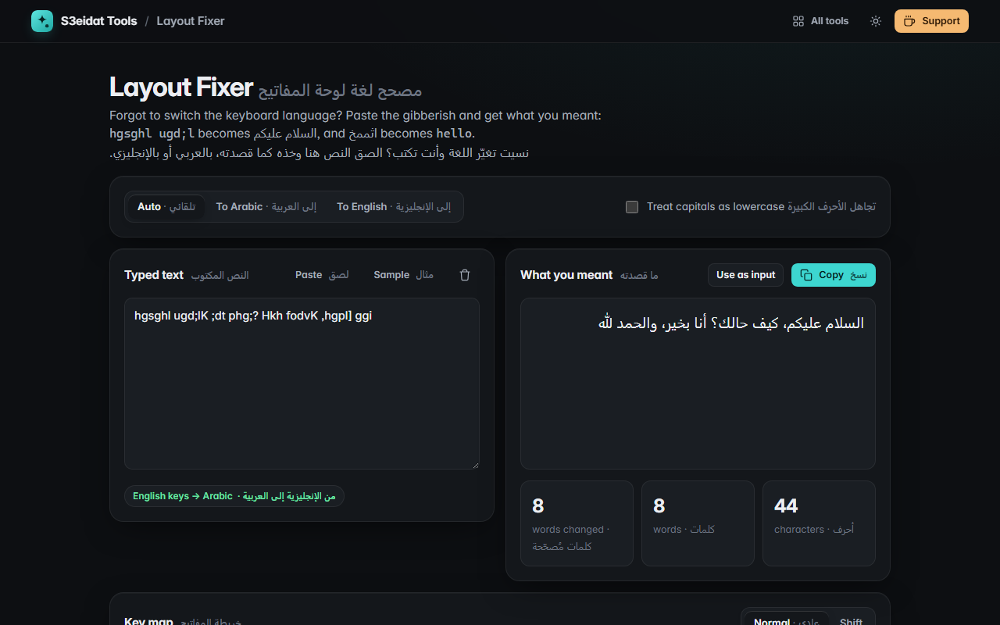

# Layout Fixer · مصحح لغة لوحة المفاتيح

> Fix text typed with the wrong keyboard language, Arabic ⇄ English. Free, private, and it runs entirely in your browser.

### ▶ [Open Layout Fixer](https://s3eidat.github.io/layout-fixer/)



## Features

- **English keys → Arabic**: `hgsghl ugd;l` becomes **السلام عليكم**, `;dt phg;?` becomes **كيف حالك؟**
- **Arabic keys → English**: `اثممخ` becomes **hello**
- Uses the standard **Arabic (101)** layout on a **US QWERTY** keyboard, including the **Shift layer** (أ إ آ, harakat, ؛ ، ؟) and the lam-alef keys (`b` → لا, `G` → لأ, `T` → لإ, `B` → لآ)
- **Auto-detects** the direction. When a text mixes both scripts, it fixes only the words that look mistyped and leaves correct words (like `meeting` inside an Arabic sentence) alone
- Ignores Caps Lock when the whole text is in capitals, or on request
- Live result, copy, "use as input", and a key map of both layers
- Bilingual interface (English and Arabic)

## Limits

- Lam-alef (لا) is both the `B` key and `G`+`H`, so going back to English it guesses from spelling (`light`, `high`, `about`). Rare words can come out with the other choice.
- Per-word guessing in mixed text uses a small letter-pair model. Very short words (2 letters) are only changed when the guess is clear; pick a direction to convert everything.
- Other layouts (Arabic 102 / AZERTY, French, Mac Arabic-QWERTY) are not supported.

## Privacy

Your text never leaves your device. There is no server, no account, no analytics.
The page ships with a strict Content-Security-Policy (`connect-src 'self'`), so the browser
itself blocks any attempt to send data anywhere.

## Run it yourself

It's plain HTML, CSS and JavaScript with no build step:

```bash
git clone https://github.com/s3eidat/layout-fixer
cd layout-fixer
python -m http.server 8000
```

Then open http://localhost:8000.

## Support

If this saved you time, **[buy me a coffee ☕](https://s3eidat.github.io/coffee/)**. It keeps every tool free.

---

Part of **[S3eidat Tools](https://s3eidat.github.io/)**: 100+ free, private tools that run in your browser. MIT licensed.
